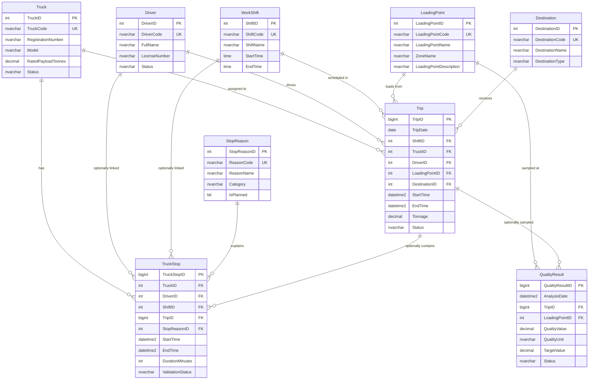

# Database Design

## Nature des données

Les données opérationnelles de cette base sont entièrement synthétiques. Elles sont inspirées de références publiques relatives à Phosboucraa et de benchmarks issus de mines à ciel ouvert comparables. Elles ne constituent ni des données internes, ni des chiffres opérationnels officiels d'OCP.

## Purpose

This SQL Server prototype supports a small mining production management and reporting MVP:

- Trips
- Truck stops
- Quality analyses
- Driver performance
- Truck performance
- Reporting dashboards

The model remains intentionally small for an internship prototype built by two first-year engineering students.

## Business Interpretation

`Trip` records represent fictional internal mining haulage movements, not truck transport over the full Boucraa-Laayoune distance.

The public inter-site transport fact used by the prototype is that phosphate from Boucraa is transported to Laayoune by the approximately 102 km conveyor. Therefore, generated trips should be interpreted as internal movements such as:

- extraction area to internal collection point;
- extraction area to crusher or treatment feed;
- extraction area to temporary stockpile;
- stockpile to internal dispatch or processing feed.

The 800 generated trips over 30 days are a partial analytical sample of recorded mining trips used for dashboard demonstration. They are not a complete monthly production register.

## Table Categories

### Reference Tables

- `dbo.Truck`
- `dbo.Driver`
- `dbo.WorkShift`
- `dbo.LoadingPoint`
- `dbo.Destination`
- `dbo.StopReason`

### Transaction Tables

- `dbo.Trip`
- `dbo.TruckStop`
- `dbo.QualityResult`

### Reporting Views

- `dbo.vw_TripDetails`
- `dbo.vw_TripsDailySummary`
- `dbo.vw_TruckStopDetails`
- `dbo.vw_StopsByReason`
- `dbo.vw_TruckPerformance`
- `dbo.vw_DriverPerformance`
- `dbo.vw_QualityByPeriod`
- `dbo.vw_GlobalProductionSummary`

## Relationships

- One truck can have many trips.
- One truck can have many truck stops.
- One driver can have many trips.
- One driver can optionally be linked to many truck stops.
- One shift can have many trips and can optionally be linked to many truck stops.
- One loading point can have many trips and quality results.
- One destination can have many trips.
- One stop reason can have many truck stops.
- One trip can optionally have truck stops and quality results.
- A quality result must be linked to at least a trip or a loading point.

## Design Decisions

- All objects use the `dbo` schema.
- Table and column names use English PascalCase.
- Reference codes are fictional and stable so they can later be mapped to real OCP fields.
- `LoadingPointDescription` was added to document that each neutral loading point code is fictional and must be confirmed with the supervisor.
- Trucks use generic fictional payload classes of 55 t, 70 t, and 90 t, not real manufacturer models.
- The driver list represents anonymized drivers appearing in the analytical sample, not the full workforce.
- The three-shift structure is a simulation hypothesis only.
- `Trip.EndTime`, `TruckStop.EndTime`, and `Trip.Tonnage` remain nullable because the schema supports incomplete operational records, even though generated stops now have valid end times.
- `TruckStop.DurationMinutes` remains a computed persisted column to prevent duration drift.
- The truck performance view still aggregates trips and stops separately before joining to `Truck`, preventing trip rows from being multiplied by stop rows.
- Quality remains a simple single-metric MVP: one `QualityResult` row represents one P2O5 analysis.

## Quality Schema Decision

The preferred multi-metric design would add a `QualityMetric` table and analysis batches. That is cleaner for P2O5, BPL, moisture, SiO2, and optional CO2, but it would also multiply visible measurement rows and require more dashboard logic.

For this MVP, the simpler option was chosen:

- keep `QualityResult` unchanged;
- treat the 120 rows as 120 P2O5 analyses;
- document BPL, moisture, SiO2/insolubles, and optional CO2 as future extensions;
- avoid presenting any prototype threshold as an official OCP acceptance rule.

This keeps the project small and preserves the validated row-count expectation of 120 quality analyses.

## Reporting Calculations

Confirmed prototype KPIs:

- Total trips: count of `Trip` rows.
- Completed trips: count of trips where `Status = 'Completed'`.
- Incomplete trips: count of trips where `Status <> 'Completed'`.
- Total tonnage: sum of completed-trip `Tonnage`.
- Average trip duration: average completed-trip duration where `EndTime` is present.
- Long trip count: completed trips with duration greater than 30 minutes.
- Long trip rate: long completed trips divided by completed trips.
- Total stops: count of `TruckStop` rows.
- Total downtime: sum of non-null `TruckStop.DurationMinutes`.
- Average stop duration: average non-null `TruckStop.DurationMinutes`.
- Average trips per shift: total driver trips divided by distinct driver trip date and shift combinations.
- P2O5 summary: count, average, minimum, and maximum `QualityValue`.

Not implemented as official KPIs:

- Availability
- Utilization
- Mechanical availability
- MTBF
- MTTR
- Payload compliance

These require supervisor-validated definitions and additional source fields.

## Assumptions

- Shift structure `SHIFT-A`, `SHIFT-B`, and `SHIFT-C` follows a simulated 3x8 h pattern only.
- Destination labels are functional prototype labels, not official OCP destination names.
- Stop reasons are benchmark-based prototype categories, not an official OCP taxonomy.
- Payload values are generated to remain compatible with fictional truck capacities.
- Long trips are analytical long trips, not official anomalies.
- P2O5 values are demonstration values only; target and status bands are not official acceptance thresholds.

## Limitations

- No GPS, IoT, AI, predictive maintenance, SAP/ERP integration, cloud deployment, mobile app, microservices, or real-time tracking.
- No authentication or application users.
- No real OCP internal data.
- No official production, quality, shift, stop, or truck-fleet rules.
- The database is intended for dashboard prototyping and later mapping to real data.

## Mermaid ER Diagram

